# Proj 4: Calibration and Augmented Reality

**Ruben A. Salido**  
**CS5330: Computer Vision and Pattern Recognition**  
**Spring 2026**

## Project Description
 

### Project Description: 

This project implements a camera calibration and augmented reality pipeline in OpenCV. The system detects a checkerboard target, selects calibration images, calibrates the camera, estimates the board pose in real time, projects reference geometry back into the image, renders virtual 3D objects anchored to the board, and detects robust image features in a separate program. The implementation is split across three main executables:

- `detect_corners` for checkerboard detection and calibration image collection
- `pose_ar` for pose estimation, reprojection, and augmented reality rendering
- `robust_features` for Harris feature detection

The calibration program stores 2D image corners and matching 3D world points, then runs `cv::calibrateCamera()` and writes the camera matrix and distortion coefficients to a YAML file. The pose-estimation program loads those intrinsics and uses `cv::solvePnP()` and `cv::projectPoints()` to render axes, projected board corners, and a custom virtual scene containing a house, tree, and sun.

The system uses a printed checkerboard as the target image. In the code, the checkerboard pattern size is set to 7 columns by 6 rows (7x6), which yields 42 corner points. The 3D world coordinates are defined in checkerboard-square units of 1x1.  
 
 
 

### TASKS 1: Detect and Extract Target Corners 

    "Indicate which type of target is being used. Describe any  
    limitations or challenges the system has in locating the target."

This system uses a checkerboard/chessboard calibration target. The image consistes of a black and white grid of squares. The sample boardhas identical squares with contains 7 x 6 inner corners that result in 42 detectable corner points. The system uses OpenCV's findChessboartdCorners() and then the image is refined by cornersSubPix() to improve sub-pixel accuracy. The program then uses drawChessboardCorners() to visualize the detected corners on the video stream. 

The reason for using a checkerboard is two-fold; most presented samples used one, and it was recommended by the assignment parameters because its geometric features are reliable in  detecting features. As for limitations or challenges of this system, the ones I took into consideration are symmetry of the board and higher contrast. The board I selected has identical squares with high contrast, however these can, in and of themselves, be an issue. The system cannot uniquely determine the board's orientation and lead to ambituity in identifying the corresponding corners across different frames. Also, since the system requires sufficient contrast, if the lighitng is inconsistent, has reflections, shadows cast onto the image, and/or an uneven surface, then the accuracy of the detection can be reduced. The board must also remain flat, since any bending may introduce minute errors in the detection of the corner positions. 

It is also worth noting that the program allows the user to capture annotated .png snapshots which display the detected corners and the coordinates of the first corner.  

 
 

### TASK 2: Select Calibration Images

    "Include a calibration image with chessboard corners highlited." 
 

##### Calibration Image 1: 

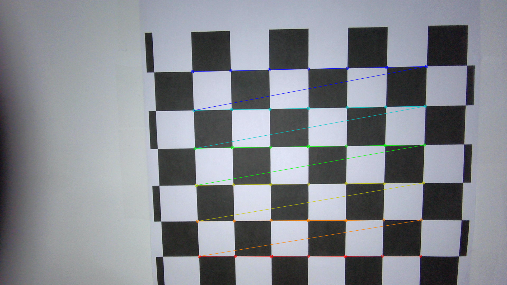
 

##### Calibration Image 2:
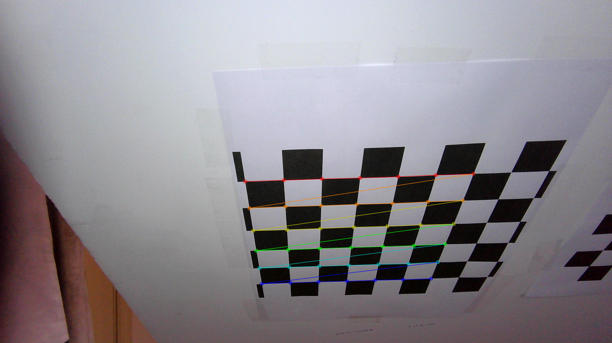
 
 
 
 

### TASK 3: Calibrate the Camera 

    "Include calibration matrix along with the corresponding re-projection  
    error."

Camera calibration was performed using a printed chessboard target with 7 × 6 inner corners, resulting in 42 detected corner points per calibration image. Multiple calibration frames were collected with the target positioned at different distances, orientations, and locations in the camera view.

The estimated intrinsic camera matrix was:  
[1192.88    0      932.03]  
[   0    1192.88   593.80]  
[   0       0         1  ]

The estimated distortion coefficients were:  
[-0.0520, 0.1727, -0.00183, -0.18699]

The final reprojection error was 0.590 pixels, indicating an accurate, not excellent, calibration. The focal lengths in the x and y directions were equal and the principal point was close to the cneter of the image, which is consistent with a successful calibration.  
 
 
 
 

### TASK 4: Calculate Current Position of the Camera

    "Include a description of how these values change as the camera,  
     or target, are moved side to side. Do they make sense?"

The camera pose was estimated using solvePnP and the calibration results file, to estimate the pose of the checkerboard in each frame.  As the camera was moved around, the output consisted of a rotation vector (rvec) and a translation vector (tvec) which changed continuously, so as the image moved relative to the camera from left to right, the x component changed the most.  The z component remained relatively stable as long as the chessboard image wasn't moved to too drastically (farther and/or closer, diagonally).  

When the board was moved closer to the camera (the camera was fixed as I held the board up to the camera), the z component decreased in magnitude, and when I moved it farther away, the z component increased. While rotating or tilting the image caused a greater change in the rotation vector values, especially for the axis corresponding to the direction of the tilt. There were no real surprises, since the pose estimate reflects the relative position and orientation between the camera and the checkerboard. 

Also, a quick note, since the object points were defined using a sqaure size of 1.0, the reported values are in checkerboard-square units instead of cm or inches. 

 
 
 
 

### TASK 5: Project Outside Corners or 3D Axes

    "Do the reprojected points show up in the right places?"

Overall, the reprojection was stable and visually consistent with the board pose. Using the pose estimated in Task 4 (rvec and tvec from solvePnP), the 3D points corresponding to the checkerboard corners were projected onto the image. This was done by using projectPoints. ProjectPoints maps 3D world coordinates into 2D image coordinates based on the camera paramaters. The projected points align, mostly, with the detected checkerboard corners to indicate that the pose estimation is accurate. Also, the 3D coordinate axes are rendered on the checkerboard to visualize the orientation of the camera relative to the target. As shown in Image 1 and 2, the projected points and axes remain stable and correctly aligned under different viewpoints. 

    "Include at least one image from this step."
 

##### Reprojected points showing, Image 1:  
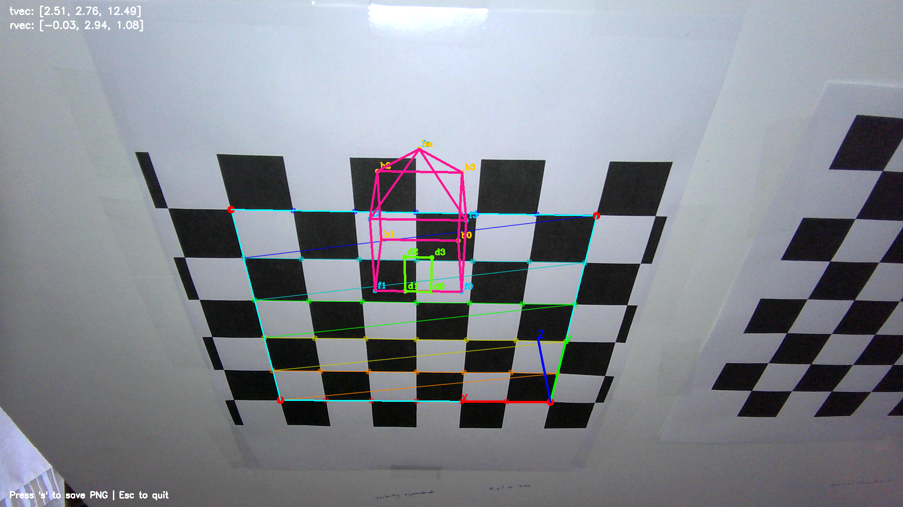
 

##### Reprojected points showing, Image 2:  
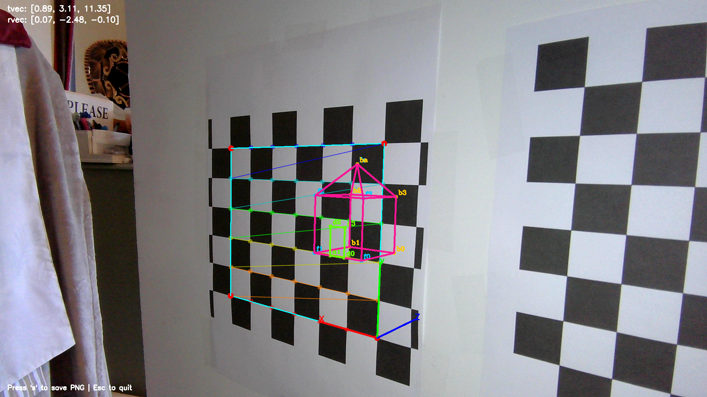
 
 
 
 

### TASK 6: Create a Virtual Object

    Describe the virtual object and take screen shots and/or videos of the system in action. 

    The virtual object is a wireframe house with an apex roofline, that floats above the checkerboard. The house is asymmetrical so that orientation errors would be easier to detect. The house also includes the labeled points to ensure orientation is easier to discern and for debugging purposes. The house consists of a rectangular shape with a square base and "ceiling", an apex roof, and a green door. The house is a hot pink and the door is an aggressive green so they stand contrast well against the image. After projection into the image, the object remained attached tothe board and stayed in the correct orienation as the image was moved, angled, rotated, and moved away from the camera. 
 

##### Virtual Object Image 1:  
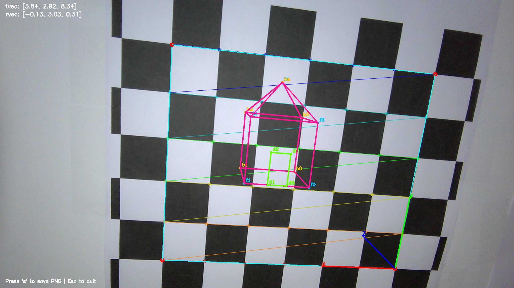
 

##### Virtual Object Image 2:  
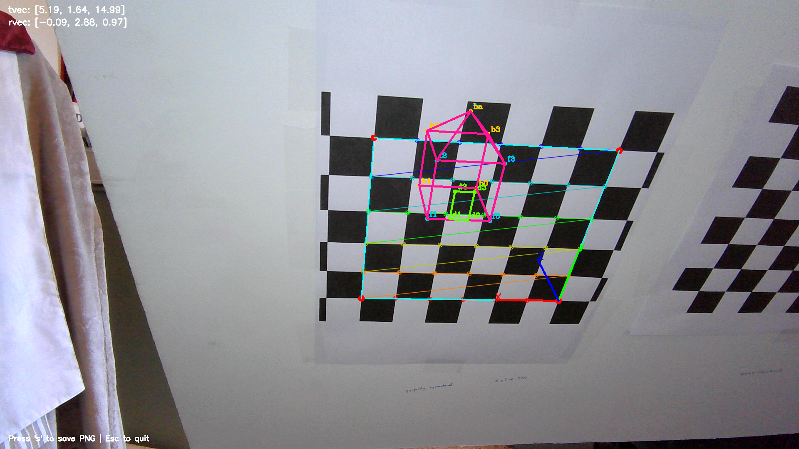
 
 
 
 

### TASK 7: Detect Robust Features

    Explain how you might be able to use those feature points as the basis for putting augmented reality (A.R.) into the image.

The robust-feature portion is implemented in a separate executable using **Harris corner detection**. Each video frame is first converted to grayscale, then the Harris response is computed with `cv::cornerHarris()`, the response image is normalized, and the points whose response exceeds the chosen threshold are drawn as red circles. The threshold can be increased with **`u`**, decreased with **`d`**, and the user can save the sample outputs to `./data/features/` with **'s'**.

Harris corners can serve as the anchors for augmented reality on a real world target if the system can detect stable feature points and consistently matched across frames. In that workflow, the system would:

1. detect strong features on a known planar object
2. match those features to previously known reference locations
3. estimate the planar pose or homography from the matches
4. use that pose estimate to anchor virtual geometry in the image

In other words, instead of relying on checkerboard corners whose geometry is predefined, the system would rely on repeatable natural feature points. This would make it possible to place AR content on posters, book covers, or other textured flat (planar) surfaces.

    Include several screenshots of the system working:
##### Detect Robust Features Image 1:
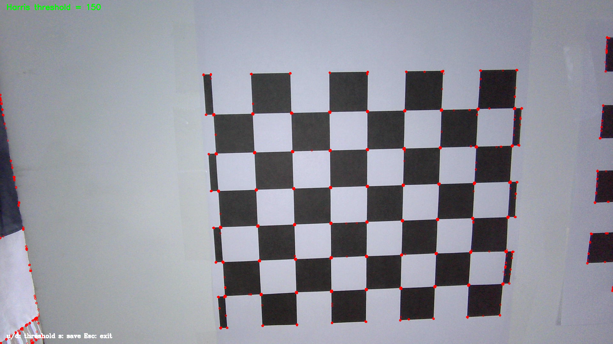
 

##### Detect Robust Features Image 2:

 

##### Detect Robust Features Image 3:
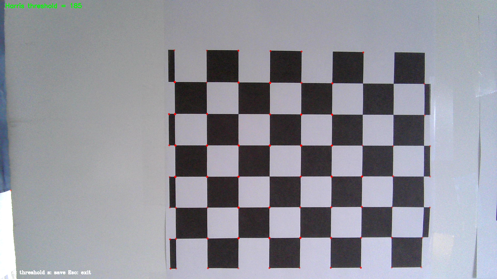
 

##### Detect Robust Features Image 4:
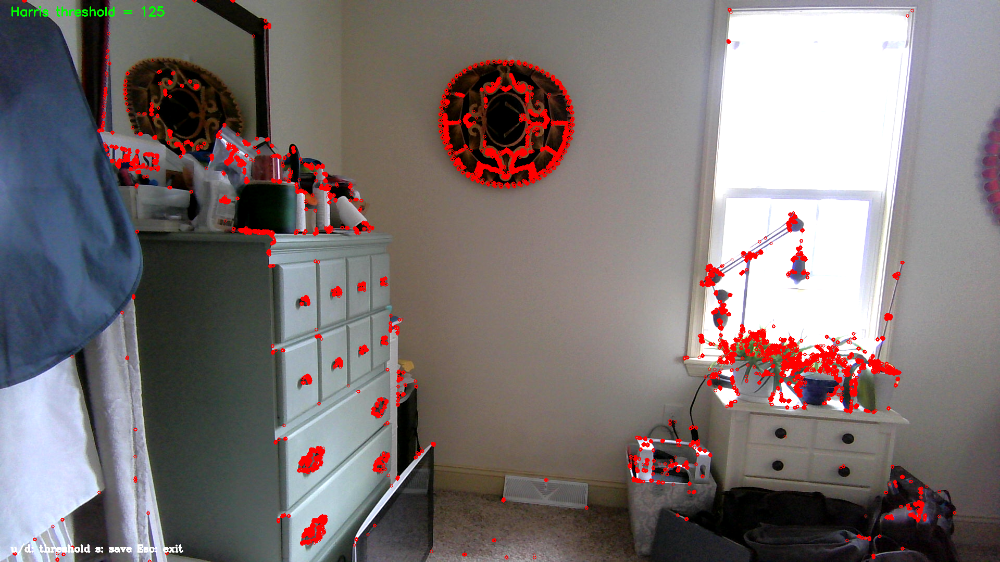
 
 
 
 

### Extensions:
For this project, the system was extended by adding two additional virtual objects: a stylized tree and a sun. Both were defined in 3D world coordinates and rendered using colored line segments. The objects are projected onto the image using the estimated camera pose, allowing them to remain properly aligned with the checkerboard as the camera moves. By including these two additional independent objects shows the system's ability to support more complex augmented reality scenes. 

##### Extension Tree and Sun Image 1:
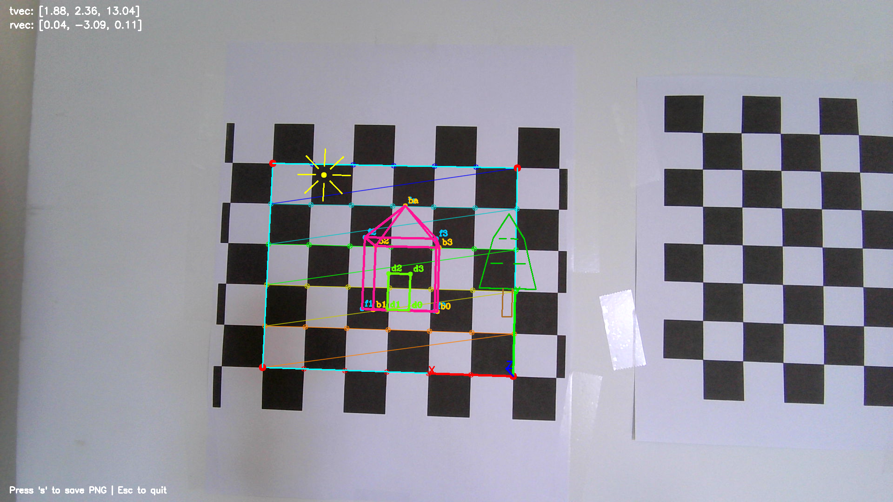
 

##### Extension Tree and Sun Image 2:
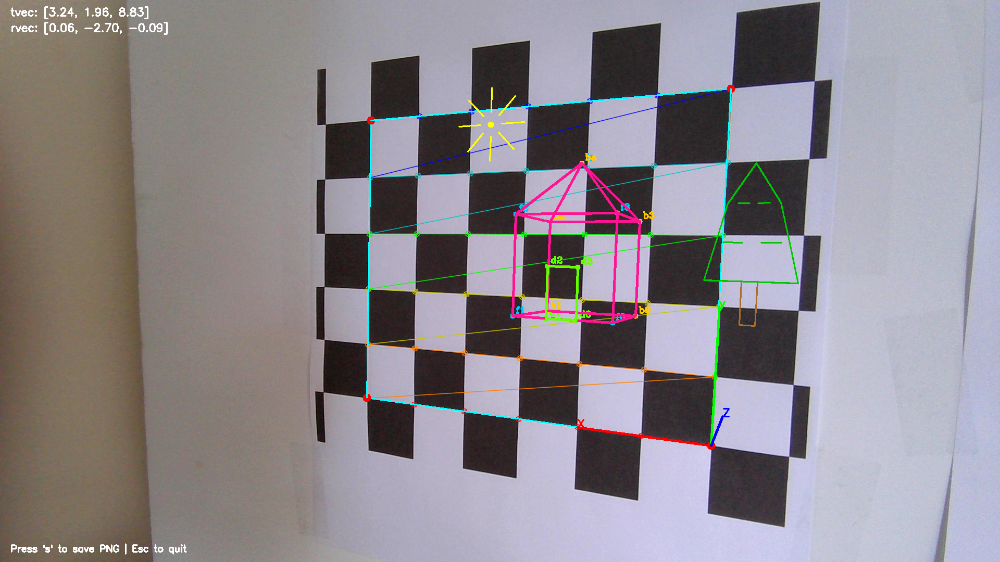
 

##### Extension Tree and Sun Image 3:
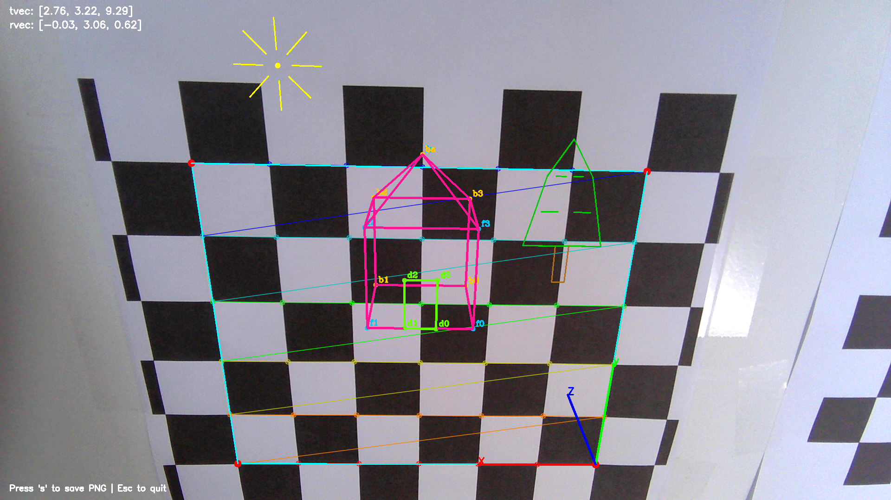
 
 

#### Reflection - What I've learned: 
In the last project, I stated, "This has been the most challenging project to date for any of my previous classes and this one." Well, I take it back, and apply it to this project. Having said that, through this project I gained a clearer understanding of the full pipeline involved in camera calibration and augmented reality; including corner detection, calibration, pose estimation, and projection. I also have a better understanding of how these components connect mathematically and in programming. I learned how solvePnP and projectPoints work together to anchor a virtual object in a scene. 

C++ was unfamiliar to me, and working on these projects made me more comfortable working with it. Over the course of these projects I've developed a better understanding of the language and was able to implement smaller functions independently. 

Another big takeway is that how important it is to leverage existing libraries (such as OpenCV), because many of the complex computer vision tasks are accessible through them. Of course, it is vital to have a solid understanding of how and when to use the provided functions, a skill which I would need to further develop if I were to go into CV as a profession. 

The most imporant takeway for me is that this project has helped me recognize areas of growth, particularly in writing concise technical explanations. My background in Spanish linguistics and literature has influenced my writing style. I am continuing to adapt it to be more direct and aligned to technical communication.  

 
 
 
 
 
 
 
 
 

#### Acknowledgments:
- https://docs.opencv.org/4.x/d9/d0c/group__calib3d.html
- https://docs.opencv.org/4.x/d9/d0c/group__calib3d.html
- https://docs.opencv.org/4.x/dc/d0d/tutorial_py_features_harris.html#:~:text=cornerSubPix()%20which%20further%20refines,neighbourhood%20it%20searches%20for%20corners
- https://www.geeksforgeeks.org/machine-learning/calibratecamera-opencv-in-python/
- https://docs.opencv.org/4.x/dc/dbb/tutorial_py_calibration.html
- https://docs.opencv.org/4.x/d5/d1f/calib3d_solvePnP.html
- https://docs.opencv.org/4.x/d7/d53/tutorial_py_pose.html
- https://docs.opencv.org/4.x/dc/d0d/tutorial_py_features_harris.html
- https://www.youtube.com/watch?v=EWqqseIjVqM
- https://www.youtube.com/watch?v=bs81DNsMrnM
- OpenCV calibration and 3D geometry documentation
- OpenCV Harris-corner tutorial
- Course materials
- GitHub Copilot for code completion and debugging assistance
- Gemini, ChatGPT, and Claude for concept clarification, debugging help, and implementation discussion
